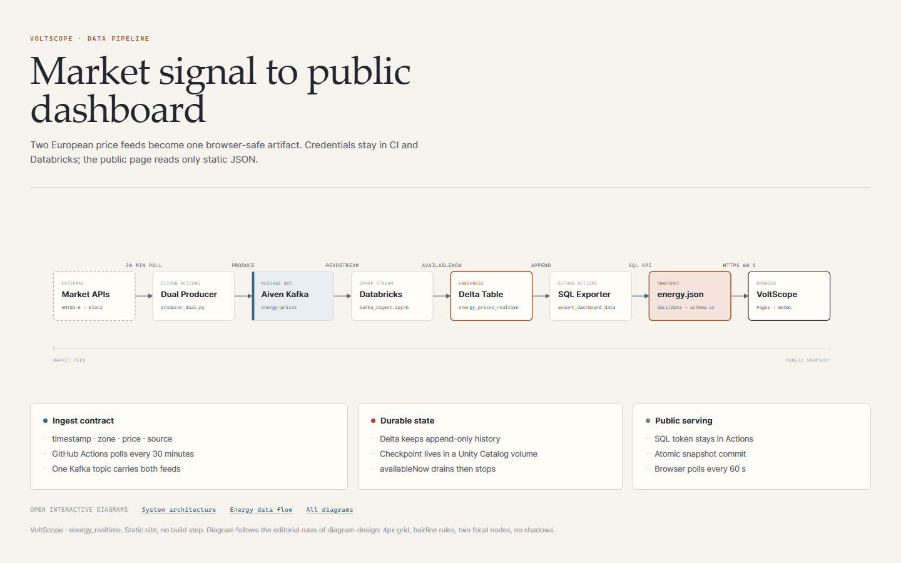
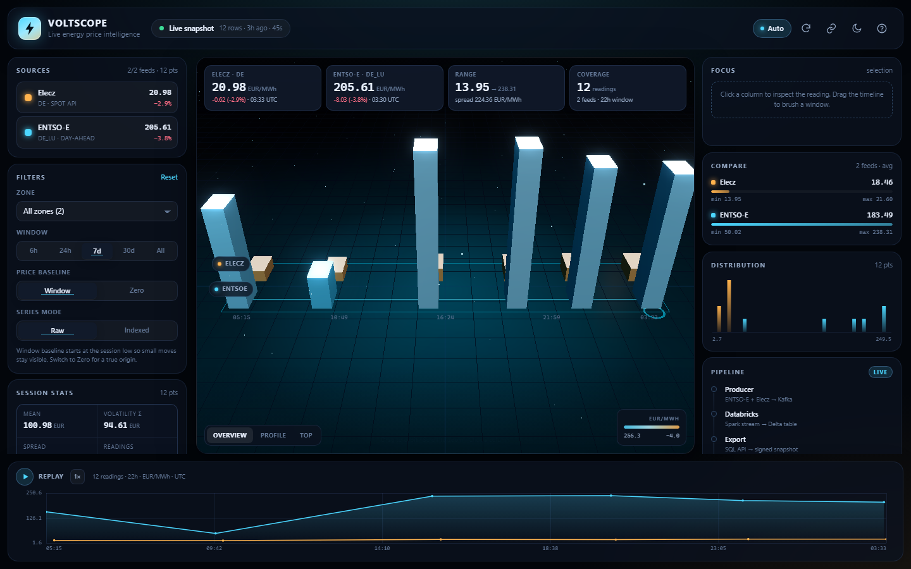
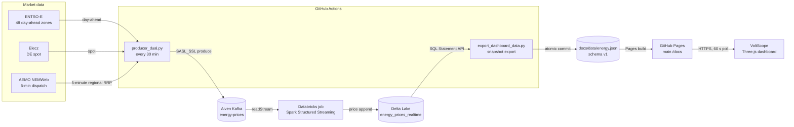
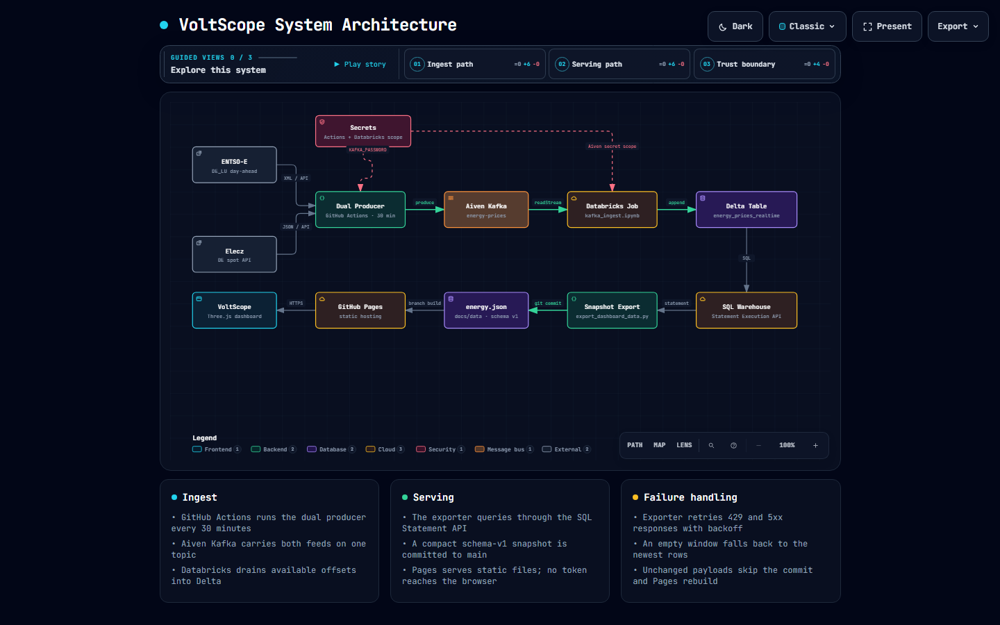
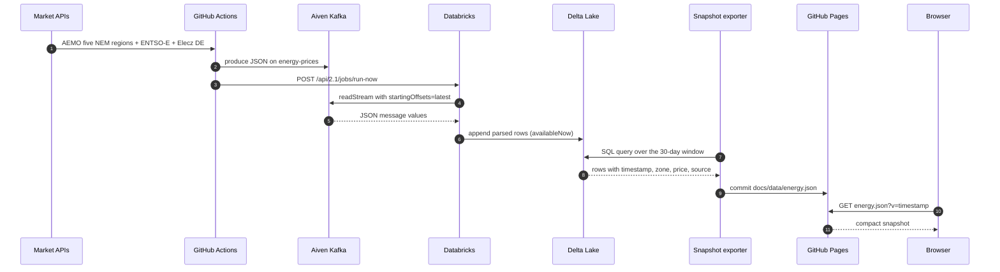
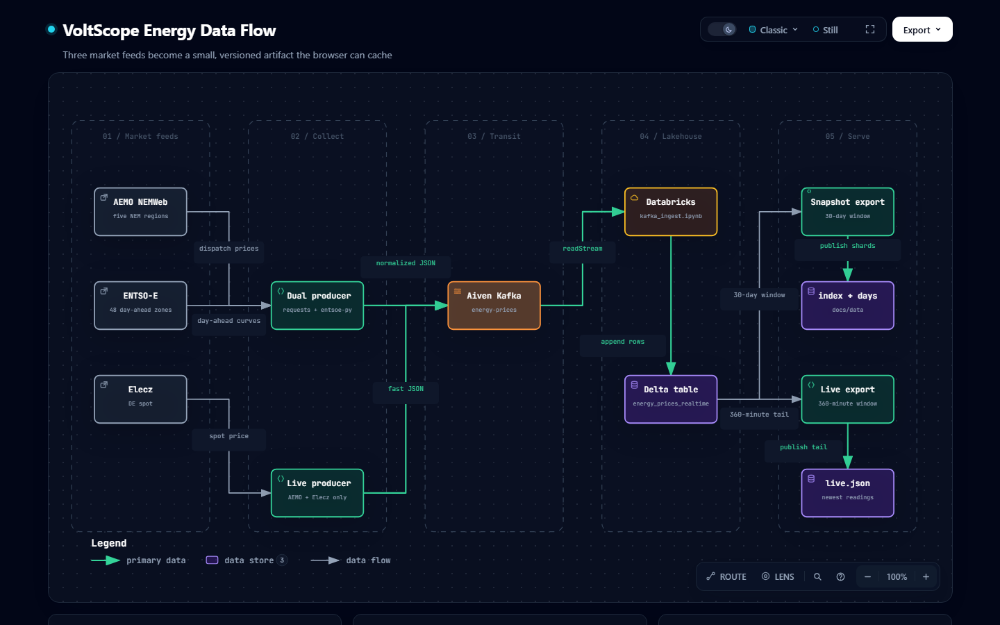
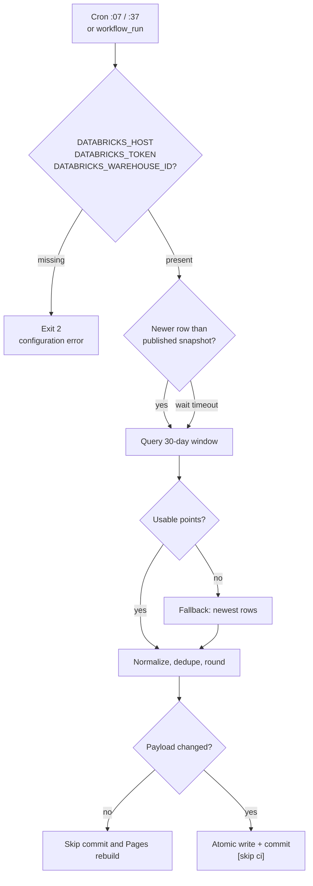

# VoltScope

**Live 3D energy price intelligence for Australia's NEM and Europe's day-ahead markets.**

VoltScope collects AEMO five-minute dispatch prices for Australia's five National Electricity Market regions from the free, public NEMWeb feed, alongside ENTSO-E day-ahead prices and Elecz DE spot. GitHub Actions sends normalized readings through Kafka into Databricks Delta Lake, then publishes a compact static snapshot to GitHub Pages. No Databricks token ever reaches the browser.

[](https://mdsaifedu.eu.cc/Energy-realtime/)
[](https://github.com/mdsarfarazalam840/Energy-realtime/actions/workflows/publish_dashboard.yml)
[](https://github.com/mdsarfarazalam840/Energy-realtime/actions/workflows/dual_to_kafka.yml)
[](#tech-stack)
[](#tech-stack)
[](#tech-stack)
[](LICENSE)

**[Live dashboard](https://mdsaifedu.eu.cc/Energy-realtime/)** · **[Interactive diagrams](https://mdsaifedu.eu.cc/Energy-realtime/diagrams/)** · **[Repository](https://github.com/mdsarfarazalam840/Energy-realtime)**

[](https://mdsaifedu.eu.cc/Energy-realtime/diagrams/pipeline.html)

---

## Table of contents

- [Overview](#overview)
- [Live surfaces](#live-surfaces)
- [Features](#features)
- [Architecture](#architecture)
- [Data flow](#data-flow)
- [Data contract](#data-contract)
- [Tech stack](#tech-stack)
- [Repository layout](#repository-layout)
- [Getting started](#getting-started)
- [Configuration](#configuration)
- [Dashboard guide](#dashboard-guide)
- [Operations](#operations)
- [Security model](#security-model)
- [Testing and quality](#testing-and-quality)
- [Deployment](#deployment)
- [Known limitations](#known-limitations)
- [Roadmap](#roadmap)
- [Contributing](#contributing)
- [License](#license)
- [Acknowledgements](#acknowledgements)

---

## Overview

Australia's NEM dispatch and Europe's day-ahead and spot electricity markets publish prices through different feeds, at different cadences, and with different schemas. VoltScope demonstrates a small, production-shaped path from those feeds to a public product:

1. **Collect** AEMO five-minute dispatch prices for NSW, Queensland, Victoria, South Australia, and Tasmania, plus ENTSO-E day-ahead prices and Elecz DE spot.
2. **Buffer** every feed on one Kafka topic with TLS and SCRAM authentication.
3. **Land** parsed JSON in a Delta table through Databricks Structured Streaming.
4. **Publish** a compact, deduplicated JSON snapshot through the Databricks SQL Statement API.
5. **Render** a static Three.js dashboard on GitHub Pages, with no server and no credentials in the browser.

The result is a live 3D price surface with source comparison, a timeline brush, distribution analysis, replay, camera presets, and shareable URL state. The pipeline is intentionally small enough to read end to end, while still showing the boundaries that matter: retries, freshness checks, atomic publication, credential isolation, and a graceful demo fallback.

The repository started from the Databricks **default-python** Declarative Automation Bundle template. The energy pipeline, exporter, dashboard, workflows, and diagrams were added on top. A few template files (`src/energy_realtime/taxis.py` and `tests/sample_taxis_test.py`) remain as template examples rather than pipeline coverage.

### What this project demonstrates

- A serverless ingestion path with no long-running cluster to babysit.
- A zone registry that adds a market with one configuration line.
- A static frontend that can be public without leaking warehouse credentials.
- A snapshot contract that is versioned, validated, and safe to cache.
- A dashboard that tells the truth when data is stale or missing.

---

## Live surfaces

| Surface | URL | What it shows |
|---|---|---|
| Dashboard | <https://mdsaifedu.eu.cc/Energy-realtime/> | Live 3D price surface, filters, replay, distribution |
| Diagram gallery | <https://mdsaifedu.eu.cc/Energy-realtime/diagrams/> | All system diagrams in one place |
| System architecture | <https://mdsaifedu.eu.cc/Energy-realtime/diagrams/architecture.html> | Interactive runtime topology and trust boundary |
| Energy data flow | <https://mdsaifedu.eu.cc/Energy-realtime/diagrams/dataflow.html> | Interactive lineage from feeds to browser |
| Editorial pipeline | <https://mdsaifedu.eu.cc/Energy-realtime/diagrams/pipeline.html> | Static HTML + SVG overview with summary cards |
| Repository | <https://github.com/mdsarfarazalam840/Energy-realtime> | Source, workflows, issues, history |

GitHub Pages serves the `docs/` folder from `main`. The custom domain is `mdsaifedu.eu.cc`; the `github.io` project URL redirects to it. The site has no build step, no npm install, and no server runtime.

### The dashboard

[](https://mdsaifedu.eu.cc/Energy-realtime/)

The status chip reads `Live snapshot` when the published JSON is fresh, shows the snapshot age, and falls back to a labelled demo snapshot when no export exists.

---

## Features

### Dashboard

- **3D price columns** rendered as instanced meshes on a reflective grid, with one lane per market zone, coloured by country.
- **Focus panel** pins a reading; hover gives the exact timestamp, zone, source, and price.
- **Compare panel** summarizes each zone: latest value, min, max, mean, standard deviation, change.
- **Distribution histogram** shows the shape of the current window.
- **Timeline brush** narrows the session; double-click clears it.
- **Replay** animates the session point by point, with 1x, 2x, and 4x speeds.
- **Camera presets** for overview, profile, and top views.
- **Window vs zero baseline** so small moves stay visible without lying about the origin.
- **Raw vs indexed mode** so feeds with different price levels can be compared by shape.
- **Shareable URL hash** captures filters, country, zone, range, baseline, series mode, and camera.
- **Auto refresh** every 60 seconds; `L` toggles it.
- **Theme toggle** with a persisted dark/light preference.
- **Demo fallback** with a deterministic synthetic snapshot when no published data exists; always labelled as demo.
- **Accessibility**: skip link, ARIA labels, keyboard shortcuts, reduced-motion handling, and a boot timeout that does not trap the page.

### Pipeline

- **Public AEMO feed**: NEMWeb five-minute dispatch prices for all five NEM regions, no API key or signup required.
- **Multi-zone feeds** in one producer: AEMO NEM dispatch, ENTSO-E day-ahead for 48 bidding zones across 34 countries, and Elecz DE spot.
- **One price scale**: AEMO's native AUD/MWh is converted to EUR/MWh using the daily public Frankfurter FX rate; native price and conversion rate are retained in Kafka.
- **Zone registry**: market zones and source mappings are centralized, with `AEMO_REGIONS`, `ENTSOE_ZONES`, and `ELECZ_ZONES` overrides.
- **Per-zone isolation**: a failed fetch logs and skips that zone; the other zones still publish.
- **Kafka security**: SASL_SSL with SCRAM-SHA-256 and a CA certificate.
- **Databricks secret scope** for the Kafka password; no password in the notebook.
- **Structured Streaming** with `availableNow`, so the job drains available offsets and stops.
- **Delta Lake** append-only history in Unity Catalog.
- **SQL Statement API** export with polling, retries, and chunk handling.
- **Snapshot guardrails**: identifier validation, finite-price checks, deduplication by `(source, zone, timestamp)`, fallback to newest rows, atomic file replacement.
- **No-op publication**: the workflow compares the normalized payload and skips the commit when nothing changed.
- **Freshness wait**: after a producer run, the exporter waits up to 420 seconds for a row newer than the published snapshot.
- **Job summary**: every publish run writes a human-readable GitHub Actions summary.

---

## Architecture

The system has four boundaries: market data sources, GitHub Actions automation, the Databricks lakehouse, and the public static site. The primary path runs left to right; the serving path wraps back to the browser.



**Open the interactive version:** [System architecture](https://mdsaifedu.eu.cc/Energy-realtime/diagrams/architecture.html)

[](https://mdsaifedu.eu.cc/Energy-realtime/diagrams/architecture.html)

### Components

| Component | Source | Responsibility |
|---|---|---|
| Market producer | `producer_dual.py` | Fetch AEMO five-minute NEM dispatch prices, ENTSO-E day-ahead prices, and Elecz DE spot; normalize and produce to Kafka |
| Kafka topic | Aiven Kafka | Durable buffer for all market price readings; topic `energy-prices` |
| Databricks job | `src/kafka_ingest.ipynb`, `resources/energy_job.yml` | Read Kafka with Structured Streaming and append price rows to Delta |
| Delta table | `workspace.default.energy_prices_realtime` | Append-only price history in Unity Catalog |
| Checkpoint volume | `/Volumes/workspace/default/energy_realtime/checkpoints` | Streaming checkpoint state |
| CA volume | `/Volumes/workspace/default/energy_realtime/aiven_ca.pem` | Kafka TLS trust material for Databricks |
| Snapshot exporter | `scripts/export_dashboard_data.py` | Query the table through the SQL Statement API, normalize, write `docs/data/energy.json` |
| Static site | `docs/` | GitHub Pages dashboard and diagram gallery |
| Browser app | `docs/assets/js/` | Three.js scene, filters, charts, replay, URL state |
| Secrets | GitHub Actions + Databricks secret scope | Keep Kafka and Databricks credentials outside the browser |

### Trust boundaries

- **Market APIs → GitHub Actions**: public HTTPS feeds; AEMO NEMWeb requires no key, while the optional ENTSO-E feed uses its API key.
- **GitHub Actions → Kafka**: SASL_SSL, SCRAM-SHA-256, CA file written from `KAFKA_CA_PEM`.
- **GitHub Actions → Databricks**: bearer token from `DATABRICKS_TOKEN`, warehouse ID from a repository variable.
- **Databricks → Kafka**: password read from the `kafka-scope` secret scope, not stored in the notebook.
- **Databricks → Delta**: Unity Catalog permissions; the bundle deploys to `workspace.default`.
- **Exporter → Pages**: the exporter only writes a static JSON file; the browser never receives a token.

---

## Data flow

The exporter is the hinge between the private lakehouse and the public web. It does not expose the warehouse; it materializes a small, versioned artifact.



**Open the interactive version:** [Energy data flow](https://mdsaifedu.eu.cc/Energy-realtime/diagrams/dataflow.html)

[](https://mdsaifedu.eu.cc/Energy-realtime/diagrams/dataflow.html)

### Stage contract

| Stage | Input | Output | Guarantee |
|---|---|---|---|
| Market feeds | AEMO NEMWeb dispatch ZIP, ENTSO-E Transparency API (48 zones), Elecz spot API | One JSON price reading per selected region/zone | Best-effort fetch per feed; a failed feed is logged and skipped |
| Producer | Normalized messages | Kafka topic `energy-prices` | One price message per selected region/zone; shared schema |
| Transport | Kafka topic | Consumer offsets | SASL_SSL, SCRAM-SHA-256, CA-verified TLS |
| Ingest | Kafka JSON values | Delta rows | `availableNow` drains available offsets, then stops |
| Storage | Append operations | `energy_prices_realtime` | Append-only history; checkpointed stream |
| Export | SQL rows | `docs/data/energy.json` | Deduplicated, finite prices, atomic write |
| Publication | Static JSON | Pages build | No token, no server, cache-busted fetch |
| Browser | Snapshot points | 3D scene and charts | 60-second auto refresh; demo fallback if missing |

### Schedule

| Workflow | Trigger | Cadence | Purpose |
|---|---|---|---|
| **Energy Market Data to Kafka** | `schedule` + `workflow_dispatch` | `*/30 * * * *` | Fetch configured regions/zones, produce to Kafka, trigger the Databricks job |
| **Publish Dashboard Snapshot** | `schedule` + `workflow_dispatch` + `workflow_run` | `7,37 * * * *` | Export a fresh snapshot, commit only when the payload changed |

The publish workflow waits up to 420 seconds for a row newer than the published snapshot when it is triggered by the producer workflow. If no fresh row arrives, it publishes the latest available snapshot and logs a warning. It also warns when the newest row is more than 120 minutes old.



---

## Data contract

### Kafka message

Every zone produces one message with the same core fields. ENTSO-E messages carry the extra `country`, `market`, and `entsoe_code` fields for future enrichment. Timestamps come from the latest index of the returned series for ENTSO-E and from the provider timestamp for Elecz, with a fetch-time fallback.

```json
{
  "timestamp": "2026-10-28T11:00:00+00:00",
  "zone": "FR",
  "price": 62.41,
  "source": "entsoe",
  "country": "FR",
  "market": "day-ahead",
  "entsoe_code": "FR"
}
```

| Field | Type | Example | Notes |
|---|---|---|---|
| `timestamp` | string | `2026-10-28T11:00:00+00:00` | ISO-8601, UTC |
| `zone` | string | `FR` / `SE3` / `DE_LU` | Public bidding-zone code; Elecz uses its own label (`DE`) |
| `price` | double | `62.41` | EUR/MWh; AEMO values are converted from AUD/MWh |
| `source` | string | `aemo` / `elecz` / `entsoe` | Feed identifier |
| `country` | string | `FR` | ISO country code; `DE` for `DE_LU` |
| `market` | string | `dispatch` / `day-ahead` / `spot` | Market label |
| `entsoe_code` | string | `FR` / `SE_3` | entsoe-py Area code; ENTSO-E messages only |

AEMO messages retain both the normalized EUR/MWh price and source-native
AUD/MWh value with the daily conversion rate:

```json
{
  "timestamp": "2026-10-28T16:00:00+00:00",
  "zone": "NSW1",
  "price": 78.33,
  "source": "aemo",
  "country": "AU",
  "market": "five-minute dispatch",
  "price_local": 123.99,
  "unit_local": "AUD/MWh",
  "fx_rate": 1.583
}
```

### Delta table

`workspace.default.energy_prices_realtime` is created by the notebook from the parsed Kafka schema. AEMO rows carry `source = "aemo"`, one of the five region codes in `zone`, a five-minute UTC timestamp, and prices in EUR/MWh (with the original AUD/MWh in Kafka only).

| Column | Spark type | Notes |
|---|---|---|
| `timestamp` | `string` | Parsed from the message; cast to `TIMESTAMP` during export |
| `zone` | `string` | Bidding zone |
| `price` | `double` | EUR/MWh |
| `source` | `string` | `aemo`, `elecz`, or `entsoe` |

The stream writes with `outputMode("append")`, `trigger(availableNow=True)`, and a checkpoint in the Unity Catalog volume. There is no `MERGE` dedupe in the Delta write; the exporter deduplicates the snapshot by `(source, zone, timestamp)`.

The notebook schema reads `timestamp`, `zone`, `price`, and `source` only. The extra `country`, `market`, `price_local`, `unit_local`, and `fx_rate` fields stay in Kafka for future enrichment and are ignored by the stream, so the Delta table needs no migration.


### Supported zones

`producer_dual.py` keeps one `ZoneConfig` line per market in `ZONE_REGISTRY`. The default run collects AEMO's five NEM regions, 48 ENTSO-E bidding zones across 34 countries, and Elecz DE spot; Italy is split into seven ENTSO-E price zones.

| Zone | Country | ENTSO-E code | Elecz | Market |
|---|---|---|---|---|
| `DE_LU` | DE | `DE_LU` | `DE` | day-ahead |
| `NL` | NL | `NL` | `NL` | day-ahead |
| `BE` | BE | `BE` | `BE` | day-ahead |
| `AT` | AT | `AT` | `AT` | day-ahead |
| `FR` | FR | `FR` | `FR` | day-ahead |
| `PL` | PL | `PL` | `PL` | day-ahead |
| `CH` | CH | `CH` | - | day-ahead |
| `CZ` | CZ | `CZ` | - | day-ahead |
| `SK` | SK | `SK` | - | day-ahead |
| `HU` | HU | `HU` | - | day-ahead |
| `SI` | SI | `SI` | - | day-ahead |
| `ES` | ES | `ES` | `ES` | day-ahead |
| `PT` | PT | `PT` | - | day-ahead |
| `SE1` | SE | `SE_1` | `SE1` | day-ahead |
| `SE2` | SE | `SE_2` | `SE2` | day-ahead |
| `SE3` | SE | `SE_3` | `SE3` | day-ahead |
| `SE4` | SE | `SE_4` | `SE4` | day-ahead |
| `NO1` | NO | `NO_1` | `NO1` | day-ahead |
| `NO2` | NO | `NO_2` | `NO2` | day-ahead |
| `NO3` | NO | `NO_3` | `NO3` | day-ahead |
| `NO4` | NO | `NO_4` | `NO4` | day-ahead |
| `NO5` | NO | `NO_5` | `NO5` | day-ahead |
| `DK1` | DK | `DK_1` | `DK1` | day-ahead |
| `DK2` | DK | `DK_2` | `DK2` | day-ahead |
| `FI` | FI | `FI` | - | day-ahead |
| `EE` | EE | `EE` | - | day-ahead |
| `LV` | LV | `LV` | - | day-ahead |
| `LT` | LT | `LT` | - | day-ahead |
| `HR` | HR | `HR` | - | day-ahead |
| `RO` | RO | `RO` | - | day-ahead |
| `BG` | BG | `BG` | - | day-ahead |
| `GR` | GR | `GR` | - | day-ahead |
| `RS` | RS | `RS` | - | day-ahead |
| `BA` | BA | `BA` | - | day-ahead |
| `ME` | ME | `ME` | - | day-ahead |
| `MK` | MK | `MK` | - | day-ahead |
| `AL` | AL | `AL` | - | day-ahead |
| `XK` | XK | `XK` | - | day-ahead |
| `MD` | MD | `MD` | - | day-ahead |
| `UA` | UA | `UA` | - | day-ahead |
| `IE_SEM` | IE | `IE_SEM` | - | day-ahead |
| `IT_NORD` | IT | `IT_NORD` | - | day-ahead |
| `IT_CNOR` | IT | `IT_CNOR` | - | day-ahead |
| `IT_CSUD` | IT | `IT_CSUD` | - | day-ahead |
| `IT_SUD` | IT | `IT_SUD` | - | day-ahead |
| `IT_SICI` | IT | `IT_SICI` | - | day-ahead |
| `IT_SARD` | IT | `IT_SARD` | - | day-ahead |
| `IT_CALA` | IT | `IT_CALA` | - | day-ahead |
| `NSW1` | AU | - | - | 5-minute dispatch |
| `QLD1` | AU | - | - | 5-minute dispatch |
| `VIC1` | AU | - | - | 5-minute dispatch |
| `SA1` | AU | - | - | 5-minute dispatch |
| `TAS1` | AU | - | - | 5-minute dispatch |

Aliases `DE`, `DE-LU`, `SE_1`…`SE_4`, `NO_1`…`NO_5`, and `DK_1`/`DK_2` resolve to the public codes. AEMO's five NEM region codes are `NSW1`, `QLD1`, `VIC1`, `SA1`, and `TAS1`; they are all enabled by default and may be restricted with `AEMO_REGIONS`.

Elecz messages keep Elecz zone labels (for example `DE` for `DE_LU`), so historical rows stay consistent with the original single-market contract.

Elecz reports cents per kWh in EUR for DE, so the producer multiplies by 10 to publish EUR/MWh. Non-German Elecz zones report local currency (`SEK`, `DKK`, `NOK`); the producer skips those prices to keep the contract. Only DE is enabled for Elecz by default.

### Snapshot

`docs/data/energy.json` is the public contract between the exporter and the browser.

```json
{
  "schema_version": 1,
  "generated_at": "2026-10-28T06:11:31Z",
  "mode": "live",
  "meta": {
    "table": "workspace.default.energy_prices_realtime",
    "warehouse_id": "3d45c676bb1ca38e",
    "window_days": 30,
    "row_count": 12,
    "raw_row_count": 12,
    "max_rows": 80000,
    "truncated": false,
    "fallback": false,
    "sources": ["aemo", "elecz", "entsoe"],
    "zones": ["AT", "BE", "DE", "DE_LU", "NSW1", "QLD1", "SA1", "TAS1", "VIC1"],
    "currency": "EUR/MWh",
    "first_timestamp": "2026-10-27T05:15:00Z",
    "first_timestamp_ms": 1793078100000,
    "latest_timestamp": "2026-10-28T03:33:43Z",
    "latest_timestamp_ms": 1793158423413,
    "query_ms": 2101,
    "publish_ms": 2101
  },
  "points": [
    { "t": 1793158423413, "z": "DE", "p": 20.9779, "s": "elecz" },
    { "t": 1793158500000, "z": "NSW1", "p": 78.326, "s": "aemo" }
  ]
}
```

| Field | Type | Meaning |
|---|---|---|
| `schema_version` | integer | Contract version; currently `1` |
| `generated_at` | string | Export time, UTC ISO-8601 |
| `mode` | string | `live` or `demo` |
| `meta` | object | Provenance, row counts, window, freshness, source/zone lists |
| `points` | array | Compact readings |

Each point uses single-letter keys to keep the payload small:

| Key | Type | Meaning |
|---|---|---|
| `t` | integer | Epoch milliseconds, UTC |
| `z` | string | Bidding zone |
| `p` | number | Price in EUR/MWh, rounded to 4 decimals |
| `s` | string | Source feed |

The browser also accepts a deterministic demo snapshot with `"mode": "demo"` and `"demo": true`. Demo data is always labelled in the UI.

### Export query

The exporter builds a parameterized, validated table name and runs:

```sql
SELECT unix_millis(CAST(timestamp AS TIMESTAMP)) AS t_ms,
       zone,
       price,
       source
FROM `workspace`.`default`.`energy_prices_realtime`
WHERE CAST(timestamp AS TIMESTAMP) >= current_timestamp() - INTERVAL 30 DAYS
ORDER BY t_ms ASC
LIMIT 80000;
```

If the window returns no rows, it falls back to the newest rows in the table. The output is written to a temporary file and atomically replaced, so a partial JSON file never reaches Pages.


---

## Tech stack

| Layer | Technology | Role |
|---|---|---|
| Market data | [AEMO NEMWeb](https://www.nemweb.com.au/REPORTS/CURRENT/DispatchIS_Reports/), [Elecz](https://elecz.com/), [ENTSO-E Transparency](https://transparency.entsoe.eu/) | Five Australian NEM dispatch regions, DE spot, 48 ENTSO-E zones |
| Scheduling | GitHub Actions | Cron producer and snapshot publisher |
| Transport | [Aiven Kafka](https://aiven.io/kafka) | Durable topic `energy-prices`, SASL_SSL, SCRAM-SHA-256 |
| Processing | [Databricks](https://www.databricks.com/), Apache Spark Structured Streaming | Parse JSON and append to Delta |
| Storage | [Delta Lake](https://delta.io/), Unity Catalog, Volumes | Table history, checkpoint, CA file |
| Query | Databricks SQL Statement Execution API | Token-scoped export from the lakehouse |
| Export | Python 3.12, `requests` | Retry, normalize, dedupe, atomic write |
| Frontend | HTML, CSS, JavaScript ES modules | No build step, no framework |
| 3D | [Three.js](https://threejs.org/) r169, WebGL | Instanced columns, bloom, camera, picking |
| Charts | Canvas 2D | Timeline and distribution |
| Hosting | GitHub Pages, `main` / `docs`, `.nojekyll` | Static site and diagram gallery |
| Deployment | [Declarative Automation Bundles](https://docs.databricks.com/dev-tools/bundles/), `uv`, Hatchling | Job deployment and wheel artifact |
| Quality | pytest, Ruff, Databricks Connect | Template tests and lint |

---

## Repository layout

```text
Energy-realtime/
├── .github/
│   └── workflows/
│       ├── dual_to_kafka.yml          # 30-minute producer + Databricks trigger
│       └── publish_dashboard.yml      # snapshot export + guarded commit
├── docs/                              # GitHub Pages root
│   ├── index.html                     # dashboard shell
│   ├── .nojekyll                      # serve files as-is
│   ├── data/
│   │   └── energy.json                # published snapshot
│   ├── assets/
│   │   ├── css/dashboard.css
│   │   ├── js/
│   │   │   ├── main.js                # controller, filters, replay, URL state
│   │   │   ├── scene.js               # Three.js stage and interaction
│   │   │   ├── charts.js              # timeline and distribution canvases
│   │   │   ├── data.js                # snapshot parsing and statistics
│   │   │   └── demo.js                # deterministic fallback snapshot
│   │   └── diagrams/                  # preview images used by the README
│   ├── diagrams/
│   │   ├── index.html                 # diagram gallery
│   │   ├── pipeline.html              # editorial static diagram
│   │   ├── architecture.html          # interactive architecture
│   │   ├── dataflow.html              # interactive data flow
│   │   └── specs/                     # Archify source specifications
│   └── README.md                      # dashboard-specific docs
├── resources/
│   └── energy_job.yml                 # Databricks job resource
├── scripts/
│   └── export_dashboard_data.py       # SQL API exporter
├── src/
│   ├── kafka_ingest.ipynb             # Structured Streaming notebook
│   └── energy_realtime/
│       ├── __init__.py
│       ├── main.py                    # template CLI entry point
│       └── taxis.py                   # template sample helper
├── tests/
│   ├── conftest.py                    # Databricks Connect fixtures
│   └── sample_taxis_test.py           # template sample test
├── fixtures/
├── producer_dual.py                   # AEMO NEM + ENTSO-E + Elecz producer
├── databricks.yml                     # bundle, targets, variables
├── pyproject.toml                     # Python package and dev tools
├── LICENSE
└── README.md
```

---

## Getting started

### Prerequisites

- **Python 3.12** for the bundle project. The producer workflow itself runs on Python 3.11.
- **[uv](https://docs.astral.sh/uv/)** for dependency and virtual environment management.
- **Databricks CLI** authenticated to a workspace with Unity Catalog and Volumes.
- **Aiven Kafka** or a compatible Kafka cluster with SASL_SSL and SCRAM-SHA-256.
- **ENTSO-E API key** for day-ahead prices (optional if running AEMO/Elecz only); AEMO NEMWeb prices are public and require no key.
- A **Databricks SQL warehouse** for the exporter.
- A GitHub repository with Actions enabled and Pages configured to serve `main` / `docs`.

### Clone and install

```bash
git clone https://github.com/mdsarfarazalam840/Energy-realtime.git
cd Energy-realtime
uv sync --dev
```

### Run the dashboard locally

The dashboard is static, but it uses ES modules and `fetch`, so it needs an origin. Do not open `index.html` with `file://`.

```bash
python -m http.server 8000 --directory docs
# open http://localhost:8000
```

If `docs/data/energy.json` is missing or invalid, the page renders a deterministic demo snapshot and labels it as demo data. The boot overlay has a 15-second timeout so a failed module graph cannot trap the page.

### Run the producer locally

```bash
pip install requests confluent-kafka entsoe-py pandas

# Write the Aiven CA certificate to aiven_ca.pem first.
export KAFKA_BOOTSTRAP="kafka-host:port"
export KAFKA_PASSWORD="..."
export ENTSOE_API_KEY="..."  # optional for AEMO-only run

# Optional: restrict the default five Australian NEM regions.
export AEMO_REGIONS="NSW1,QLD1,VIC1,SA1,TAS1"
# Optional European feeds (configured when credentials/API access are available).
export ENTSOE_ZONES="DE_LU,FR,NL,BE,AT,ES,PL,SE1,NO1,DK1"
export ELECZ_ZONES="DE_LU"

python producer_dual.py
```

On PowerShell:

```powershell
$env:KAFKA_BOOTSTRAP = "kafka-host:port"
$env:KAFKA_PASSWORD = "..."
$env:ENTSOE_API_KEY = "..."  # optional for AEMO-only run
$env:AEMO_REGIONS = "NSW1,QLD1,VIC1,SA1,TAS1"
$env:ENTSOE_ZONES = "DE_LU,FR,NL,BE,AT,ES,PL,SE1,NO1,DK1"
python producer_dual.py
```

Inspect the registry and test a fetch without Kafka:

```bash
python producer_dual.py --list-zones
python producer_dual.py --dry-run --zone NSW1,QLD1,VIC1,SA1,TAS1
```

`--dry-run` fetches the live AEMO report and prints normalized messages without Kafka credentials. `--zone` accepts comma-separated AEMO codes such as `NSW1,SA1`; `--aemo-regions all` selects the five NEM regions. AEMO data needs no key; ENTSO-E zones are skipped if `ENTSOE_API_KEY` is absent, while Elecz remains independently enabled.

**AEMO smoke-test result:** the public NEMWeb current dispatch ZIP was retrieved and parsed successfully, producing one normalized message for each of NSW1, QLD1, VIC1, SA1, and TAS1. This local dry run does not publish to Kafka. Full Kafka → Databricks → GitHub Pages verification still requires the configured Kafka and Databricks credentials/services; do not treat this source test as proof that the hosted end-to-end pipeline is live. After configuring those services, dispatch **Energy Market Data to Kafka**, then confirm the resulting dashboard snapshot includes `aemo` in `meta.sources` and Australian region codes in `meta.zones`.

`producer_dual.py` uses `ssl.ca.location = "aiven_ca.pem"` by default; set `KAFKA_CA_LOCATION` to override. The Kafka username defaults to the non-secret `avnadmin`; set `KAFKA_USERNAME` to change it. The password comes from `KAFKA_PASSWORD`.

### Run the exporter locally

```bash
pip install "requests==2.32.3"

export DATABRICKS_HOST="https://dbc-xxxx.cloud.databricks.com"
export DATABRICKS_TOKEN="..."
export DATABRICKS_WAREHOUSE_ID="..."

python scripts/export_dashboard_data.py \
  --window-days 30 \
  --out docs/data/energy.json
```

Useful flags:

| Flag | Default | Purpose |
|---|---|---|
| `--out` | `docs/data/energy.json` | Output path |
| `--table` | `workspace.default.energy_prices_realtime` | Fully qualified table |
| `--window-days` | `30` | History window |
| `--max-rows` | `80000` | Hard row cap |
| `--wait-new-data` | `0` | Seconds to wait for a row newer than the published snapshot |
| `--max-wait` | `240` | Maximum time for a SQL statement |
| `--dry-run` | off | Build and validate the snapshot without writing |

### Deploy the Databricks bundle

```bash
databricks configure
databricks bundle validate --target dev
databricks bundle deploy --target dev
databricks bundle run energy_kafka_job --target dev
```

The bundle builds a wheel with `uv build --wheel`, includes every YAML in `resources/`, and deploys the `energy_kafka_job` with the notebook task from `src/kafka_ingest.ipynb`.

Targets:

| Target | Mode | Catalog | Schema | Notes |
|---|---|---|---|---|
| `dev` | `development` | `workspace` | Current user's short name | Default; schedules paused; resources prefixed |
| `prod` | `production` | `workspace` | `prod` | Single copy under the configured root path; `CAN_MANAGE` for the owner |

Production deploy:

```bash
databricks bundle deploy --target prod
databricks bundle run energy_kafka_job --target prod
```

The notebook expects these Unity Catalog volumes to exist:

- `/Volumes/workspace/default/energy_realtime/checkpoints`
- `/Volumes/workspace/default/energy_realtime/aiven_ca.pem`

It also expects a Databricks secret scope named `kafka-scope` with key `aiven-password`. Create them before the first run.

---

## Configuration

### GitHub Actions secrets

Set these under **Settings → Secrets and variables → Actions → Secrets**.

| Secret | Used by | Purpose |
|---|---|---|
| `KAFKA_BOOTSTRAP` | Producer | Kafka bootstrap servers |
| `KAFKA_PASSWORD` | Producer | SCRAM password for `avnadmin` |
| `KAFKA_CA_PEM` | Producer | CA certificate written to `aiven_ca.pem` |
| `ENTSOE_API_KEY` | Producer | Optional ENTSO-E Transparency API key |
| `DATABRICKS_HOST` | Producer trigger, exporter | Workspace URL |
| `DATABRICKS_TOKEN` | Producer trigger, exporter | Databricks personal access token |

### GitHub Actions variables

Set these under **Settings → Secrets and variables → Actions → Variables**.

| Variable | Default | Purpose |
|---|---|---|
| `DATABRICKS_WAREHOUSE_ID` | none, required | SQL warehouse used by the exporter |
| `ENERGY_TABLE` | `workspace.default.energy_prices_realtime` | Table queried by the exporter |
| `AEMO_REGIONS` | `NSW1,QLD1,VIC1,SA1,TAS1` | Comma-separated NEM regions; `all` selects all five |
| `ENTSOE_ZONES` | 48-zone default | Comma-separated ENTSO-E zones; `all` uses the whole registry |
| `ELECZ_ZONES` | `DE_LU` | Comma-separated Elecz zones, or `all` |
| `ENTSOE_LOOKBACK_HOURS` | `48` | Hours of day-ahead history to read |

### Producer environment

| Variable | Default | Purpose |
|---|---|---|
| `AEMO_REGIONS` | Five NEM regions | Public AEMO regions, comma-separated or `all`; no API key required |
| `ENTSOE_API_KEY` | none | Optional ENTSO-E Transparency API key |
| `ENTSOE_ZONES` | 48-zone default | Zones to fetch, comma-separated; `all` uses the registry |
| `ELECZ_ZONES` | `DE_LU` | Elecz zones to fetch; non-EUR prices are skipped |
| `ENTSOE_LOOKBACK_HOURS` | `48` | Hours of day-ahead history read per zone |
| `KAFKA_BOOTSTRAP` | none, required | Kafka bootstrap servers |
| `KAFKA_PASSWORD` | none, required | SCRAM password |
| `KAFKA_USERNAME` | `avnadmin` | SCRAM username |
| `KAFKA_CA_LOCATION` | `aiven_ca.pem` | CA bundle path |
| `ELECZ_ALLOW_NON_EUR` | `0` | Set `1` only if you add currency conversion |

### Databricks configuration

| Item | Value |
|---|---|
| Secret scope | `kafka-scope` |
| Secret key | `aiven-password` |
| Kafka bootstrap | Configured in `src/kafka_ingest.ipynb` |
| Kafka topic | `energy-prices` |
| Security protocol | `SASL_SSL` |
| SASL mechanism | `SCRAM-SHA-256` |
| CA truststore | `/Volumes/workspace/default/energy_realtime/aiven_ca.pem` |
| Checkpoint | `/Volumes/workspace/default/energy_realtime/checkpoints` |
| Target table | `energy_prices_realtime` |
| Trigger | `availableNow` |

### Exporter environment

| Variable | Default | Purpose |
|---|---|---|
| `DATABRICKS_HOST` | none, required | Workspace URL; `https://` is added if missing |
| `DATABRICKS_TOKEN` | none, required | Bearer token; never commit |
| `DATABRICKS_WAREHOUSE_ID` | none, required | SQL warehouse id |
| `ENERGY_TABLE` | `workspace.default.energy_prices_realtime` | Fully qualified table |
| `ENERGY_WINDOW_DAYS` | `30` | History window |
| `ENERGY_MAX_ROWS` | `80000` | Row cap |
| `ENERGY_WAIT_NEW_DATA` | `0` | Freshness wait in seconds |
| `ENERGY_MAX_WAIT` | `240` | SQL statement timeout in seconds |
| `DASHBOARD_OUT` | `docs/data/energy.json` | Output path |

---

## Dashboard guide

The dashboard is a single static page. All state lives in the browser and, when shared, in the URL hash.

### Interactions

| Action | Result |
|---|---|
| Hover a column | Tooltip with timestamp, zone, source, price |
| Click a column | Pin the reading in **Focus** |
| Drag across the timeline | Brush a time window |
| Double-click the timeline | Clear the brush |
| Drag the scene | Orbit the camera |
| Scroll | Zoom |
| Right-drag | Pan |
| Replay button / `Space` | Play or pause the session |
| Speed selector | 1x, 2x, 4x |
| `1` / `2` / `3` | Overview / profile / top camera |
| `F` | Focus the selected column |
| `R` | Refresh the snapshot |
| `L` | Toggle auto refresh |
| `Esc` | Clear selection |
| `?` | Open help |
| Share button | Copy a URL that reproduces the current view |

### Filters

| Control | Options | Notes |
|---|---|---|
| Sources | AEMO, Elecz, ENTSO-E | At least one source stays enabled |
| Country | All countries, plus every country in the snapshot | Populated from zone prefixes |
| Zone | All zones in the selected country, plus every zone in the snapshot (`DE_LU`, `FR`, `SE3`, ...) | Populated from the snapshot |
| Window | 6h, 24h, 7d, 30d, All | Anchored on the newest raw row |
| Price baseline | Window, Zero | Window starts at the session low; Zero keeps a truthful origin |
| Series mode | Raw, Indexed | Indexed rebases each zone to 100 at its first visible reading |

### Theme and persistence

- Theme and auto-refresh preference are stored in `localStorage` under `voltscope.theme` and `voltscope.live`.
- Filter state is encoded in the URL hash so a shared link is reproducible.
- The page polls `data/energy.json` every 60 seconds with a cache-busting query parameter.
- The boot overlay hides only after the scene and snapshot are ready, with a 15-second failure timeout.

---

## Operations

### Runbook

1. **Check the producer workflow.** If it failed, the publish workflow will not receive a `workflow_run` event. Run **Energy Market Data to Kafka** manually from the Actions tab.
2. **Check the Databricks job run.** The producer workflow calls `/api/2.1/jobs/run-now` with the configured job id. A failed run usually means the secret scope, CA volume, checkpoint volume, or Kafka credentials are wrong.
3. **Check the exporter run.** The publish workflow logs the table, row count, sources, latest reading, and query time in the job summary.
4. **Check freshness.** The exporter warns when the newest row is more than 120 minutes old. The dashboard status chip also shows the snapshot age.
5. **Check the snapshot file.** A missing or invalid `docs/data/energy.json` makes the dashboard fall back to demo data.

### Common failures

| Symptom | Likely cause | Fix |
|---|---|---|
| Producer logs `ENTSOE_API_KEY not set, skipping` | Missing secret or local env var | Add `ENTSOE_API_KEY`; Elecz can still publish |
| Producer logs `Unknown zone` | Zone code not in `ZONE_REGISTRY` | Use a code from `--list-zones` or add one `ZoneConfig` line |
| Producer logs `skipping to keep the EUR/MWh contract` | Elecz returned a non-EUR zone | Expected for non-DE Elecz zones; leave it disabled or add conversion |
| Producer logs `Elecz response format unexpected` | Upstream response changed | Inspect the response and update the field mapping |
| Kafka send error / TLS failure | CA file missing or password wrong | Recreate `aiven_ca.pem`; verify `KAFKA_PASSWORD` |
| Databricks job fails immediately | Secret scope or volume missing | Create `kafka-scope` and the Unity Catalog volumes |
| Exporter exits `2` | Missing `DATABRICKS_HOST`, `DATABRICKS_TOKEN`, or `DATABRICKS_WAREHOUSE_ID` | Set the secret/variable; rerun |
| Exporter returns `401` / `403` | Expired or under-scoped token | Rotate the token; confirm warehouse access |
| Exporter returns `404` | Wrong table name or schema | Set `ENERGY_TABLE`; verify the table exists |
| Exporter logs `table returned no usable price rows` | Empty table or all rows invalid | Run the producer and Databricks job; inspect the table |
| Snapshot unchanged | Payload identical after normalization | Expected; the workflow skips the commit |
| Dashboard shows demo data | Snapshot missing, empty, or invalid JSON | Run the exporter; validate the JSON |
| Dashboard is stale | Pages build pending or browser cache | Wait for Pages, hard reload, check the workflow |
| Pages 404 | Pages source not `main` / `docs` | Fix **Settings → Pages** |

### Credential rotation

1. Rotate the Aiven Kafka password in the Aiven console.
2. Update the GitHub secret `KAFKA_PASSWORD`.
3. Update the Databricks secret `kafka-scope/aiven-password`.
4. Rotate the Databricks token in the workspace.
5. Update the GitHub secret `DATABRICKS_TOKEN`.
6. Run both workflows manually and confirm fresh rows and a new snapshot.

### Cost and limits

- **GitHub Actions**: free minutes depend on the repository plan; the producer runs for a few minutes every 30 minutes.
- **GitHub Pages**: static hosting is free for public repositories, subject to GitHub's published limits.
- **Aiven Kafka** and **Databricks** are external services and bill according to their own plans. The Databricks Free Edition has compute and volume limits.
- The exporter caps history at **30 days** and **80,000 rows** by default.
- The publish workflow has an **18-minute** timeout.
- The dashboard polls every **60 seconds**; it does not query Databricks directly.

---

## Security model

VoltScope is designed so the public artifact contains no credentials.

- **No token in the browser.** The dashboard fetches a static JSON file. The Databricks token exists only in GitHub Actions secrets.
- **No password in the notebook.** The Kafka password is read at runtime from the Databricks secret scope.
- **Public AEMO feed.** NEMWeb prices require no API key; the optional ENTSO-E key lives only in GitHub Actions secrets and the browser never sees it.
- **No secrets in git.** The repository ignores `.databricks/`, local bundle state, and Python build output. `aiven_ca.pem`, tokens, and passwords must never be committed.
- **Identifier validation.** The exporter rejects table names that do not match `[A-Za-z0-9_.\-]+` before quoting them.
- **Narrow write scope.** Only the publish workflow requests `contents: write`; the producer workflow does not.
- **Public by design.** The snapshot contains market prices, zones, sources, and timestamps. It contains no personal data.
- **Least privilege is still manual.** Use a dedicated Databricks token with access only to the required warehouse and table. Rotate it on a schedule.
- **Kafka endpoint and username are not secrets.** The notebook contains the bootstrap host and `avnadmin`; the password is the secret. Treat the CA certificate as public material.

Recommended hardening:

- Protect `main` with required reviews and status checks.
- Restrict who can edit Actions secrets and variables.
- Use environment-scoped secrets for production.
- Add a secret scanner such as GitHub secret scanning or `gitleaks` to CI.
- Pin third-party Actions by commit SHA instead of a moving tag.
- Add a content security policy to the Pages site if you vendor Three.js.

---

## Testing and quality

### What runs today

```bash
uv sync --dev
uv run pytest
ruff check .
```

`tests/conftest.py` configures Databricks Connect and falls back to serverless compute when no cluster is specified. The included `tests/sample_taxis_test.py` is a template smoke test against `samples.nyctaxi.trips`; it verifies the test harness, not the energy pipeline.

### Manual smoke tests

```bash
# List the zone registry
python producer_dual.py --list-zones

# Fetch the public AEMO prices without producing to Kafka
python producer_dual.py --dry-run --zone NSW1,SA1

# Validate the exporter without writing
python scripts/export_dashboard_data.py --dry-run

# Validate the snapshot shape
python -c "import json; d=json.load(open('docs/data/energy.json')); assert d['schema_version']==1; assert d['points']; print(len(d['points']), 'points')"

# Serve the dashboard
python -m http.server 8000 --directory docs
```

Check the dashboard at desktop and mobile widths, toggle dark/light, test keyboard shortcuts, and enable **Reduce motion** in the OS to confirm the replay and reveal animations respect it.

### Load and user tests

The dashboard has a repeatable load and browser audit suite in `tests/load/`. It
serves a local mirror of `docs/`, so it never touches the public Pages host.

```bash
node tests/load/serve_docs.mjs --root docs --port 8000 --workers 4
node tests/load/load_test.mjs --users 1000 --duration 60 --scenario revalidate
python tests/load/generate_snapshot.py --points 80000 --zones 49 --out tests/load/data/energy-80k.json
python tests/load/ui_audit.py --snapshot tests/load/data/energy-80k.json --label 80k --soak 5
```

At 1000 concurrent users against the 80k-row snapshot, ETag revalidation holds
p95 at 298 ms with 0.6 KB per poll (about 24.5 GB/month if those users stayed
connected 24/7). The old cache-busting behaviour needs 878 KB per poll and about
37.9 TB/month. The browser audit passes 64/64 checks on the published sample, a
10k-row snapshot, and an 80k-row snapshot at desktop and mobile widths.

Never run a load test against the live site; GitHub's Acceptable Use policy
forbids unsolicited load. See [`tests/load/README.md`](tests/load/README.md) for
scenarios, budgets, and results.

### Diagram validation

The interactive diagrams are generated from JSON specifications with [Archify](https://github.com/tt-a1i/archify). If you change a spec, validate before committing:

```bash
node bin/archify.mjs validate architecture docs/diagrams/specs/architecture.json --quality showcase --json
node bin/archify.mjs validate dataflow docs/diagrams/specs/dataflow.json --quality showcase --json
```

The editorial pipeline follows the [diagram-design](https://github.com/cathrynlavery/diagram-design) rules: 4px grid, hairline rules, one accent family, no shadows, and a single primary path.

---

## Deployment

### GitHub Pages

1. Open **Settings → Pages**.
2. Set **Source** to **Deploy from a branch**.
3. Choose branch `main` and folder `/docs`.
4. Save. The site builds on the next push to `main`.
5. Optional: set the custom domain to `mdsaifedu.eu.cc` and enable HTTPS.

`docs/.nojekyll` disables Jekyll processing, so files and folders that start with an underscore are served as-is.

The publish workflow commits `docs/data/energy.json` with `[skip ci]`, which prevents a snapshot commit from retriggering the workflow. It compares the normalized payload and skips the commit when only timestamps or query timings changed.

### Databricks bundle

```bash
databricks bundle validate --target dev
databricks bundle deploy --target dev
databricks bundle run energy_kafka_job --target dev

databricks bundle deploy --target prod
databricks bundle run energy_kafka_job --target prod
```

The production target deploys one copy under `/Workspace/Users/ajaysin840@gmail.com/.bundle/energy_realtime/prod` and grants `CAN_MANAGE` to the configured owner. Adjust the workspace host, root path, catalog, and permissions in `databricks.yml` for your own account before deploying.

### First-run checklist

- [ ] Kafka topic `energy-prices` exists.
- [ ] `aiven_ca.pem` exists in the Unity Catalog volume.
- [ ] Checkpoint volume exists.
- [ ] Databricks secret `kafka-scope/aiven-password` exists.
- [ ] SQL warehouse id is stored in `DATABRICKS_WAREHOUSE_ID`.
- [ ] `DATABRICKS_HOST` and `DATABRICKS_TOKEN` are stored as secrets.
- [ ] The Databricks job runs successfully once.
- [ ] The exporter writes a non-empty `docs/data/energy.json`.
- [ ] Pages is configured for `main` / `docs`.
- [ ] The dashboard shows live rows, not demo data.

---

## Known limitations

- **`startingOffsets=latest` can skip data.** If the Databricks job is down while the producer writes, those offsets are not replayed. Use `earliest` or a stored offset policy if exact-once ingest matters.
- **Delta writes are append-only.** There is no `MERGE` deduplication in the table; duplicates are removed only when the snapshot is built.
- **The public history is capped.** The exporter defaults to 30 days and 80,000 rows. Older rows remain in Delta but are not published.
- **The dashboard is not a real-time feed.** It polls a static JSON file every 60 seconds. It is near-real-time, not streaming to the browser.
- **The template tests are not pipeline tests.** `sample_taxis_test.py` exercises Databricks Connect, not the energy contract.
- **Three.js is vendored, not upgraded automatically.** `docs/assets/vendor/three/` pins r169. Refresh those files together with any addon import when you upgrade.
- **The demo fallback is synthetic.** It is deterministic and clearly labelled, but it is not market data.
- **Elecz is DE-only by default.** Other Elecz zones return local currency (`SEK`, `DKK`, `NOK`), so the producer skips them instead of publishing a mixed-unit price.
- **AEMO prices are FX-converted.** AEMO publishes AUD/MWh. VoltScope converts with the daily Frankfurter AUD/EUR reference rate, so FX movements affect the EUR/MWh comparison lane; the original AUD price and conversion rate remain in Kafka.
- **NEMWeb is a file feed, not a REST API.** The producer downloads the newest zipped C/I/D/F CSV report and maps the table's declared columns; AEMO may change report schemas or availability.
- **Older Elecz rows predate the unit conversion.** Rows written before the c/kWh to EUR/MWh fix stay on the old scale in Delta for up to 30 days.
- **The all-zones view is dense.** Each zone gets its own lane; lane labels are collision-culled as the camera moves. Pick a country or zone for a clean view.
- **ENTSO-E publishes day-ahead prices in the afternoon.** The producer reads a 48-hour lookback so a run still finds the latest published series.
- **Zone coverage is configurable.** The registry includes five AEMO NEM regions and 48 ENTSO-E bidding zones; `AEMO_REGIONS`, `ENTSOE_ZONES`, and `ELECZ_ZONES` limit a run.
- **There is no alerting.** A failed workflow or stale snapshot is visible in Actions and the dashboard, but it does not page anyone.
- **Upstream APIs can change.** Elecz is an undocumented spot endpoint; a response change requires a producer update.
- **The bundle targets are account-specific.** `databricks.yml` contains a workspace host, owner, and root path. Change them before deploying elsewhere.

---

## Roadmap

- [ ] Add contract tests for the Kafka message and snapshot schema.
- [ ] Add data-quality expectations in the Databricks pipeline.
- [ ] Replace append-only ingest with `MERGE` and a watermark for idempotent rows.
- [ ] Add freshness alerting to GitHub Issues or a webhook.
- [x] Add multi-zone support: 48 ENTSO-E zones across 34 countries.
- [x] Add public AEMO five-minute NEM dispatch prices with regional lanes.
- [x] Add per-zone lanes, country colours, and a country filter to the scene and timeline.
- [ ] Add non-DE Elecz zones with EUR conversion.
- [ ] Add forecast vs actual overlays and negative-price callouts.
- [x] Vendor Three.js for offline and air-gapped use.
- [ ] Add Terraform or Pulumi for Kafka, volumes, and warehouse resources.
- [ ] Pin third-party Actions by commit SHA.
- [ ] Add a screenshot regression check for the dashboard and diagrams.

---

## Contributing

1. Fork the repository and create a branch from `main`.
2. Install dependencies with `uv sync --dev`.
3. Keep the data contract stable. If you change `points`, `meta`, or `schema_version`, update the exporter, the dashboard parser, and [docs/README.md](docs/README.md) together.
4. Run `ruff check .` and `uv run pytest`.
5. Serve `docs/` locally and test the dashboard at desktop and mobile widths.
6. If you change a diagram, edit the JSON spec and validate it with Archify before committing the generated HTML.
7. Do not commit secrets, `aiven_ca.pem`, `.databricks/`, or generated build output.
8. Open a pull request with a short description, test evidence, and screenshots for UI changes.

Commit messages in this repository follow Conventional Commits (`feat:`, `fix:`, `docs:`, `chore:`, `ci:`).

---

## License

MIT. See [LICENSE](LICENSE).

---

## Acknowledgements

- [Databricks](https://www.databricks.com/) for the Declarative Automation Bundle template, Delta Lake, and the SQL Statement API.
- [Aiven](https://aiven.io/) for managed Kafka.
- [ENTSO-E](https://transparency.entsoe.eu/) and [Elecz](https://elecz.com/) for the public price feeds.
- [AEMO NEMWeb](https://www.nemweb.com.au/REPORTS/CURRENT/DispatchIS_Reports/) for free public five-minute NEM dispatch reports.
- [Three.js](https://threejs.org/) for the WebGL stage.
- [Archify](https://github.com/tt-a1i/archify) for the interactive architecture and data-flow diagrams.
- [diagram-design](https://github.com/cathrynlavery/diagram-design) for the editorial diagram rules used by the pipeline overview.
- GitHub Pages and GitHub Actions for free hosting and automation.

---

## Links

- **Live dashboard:** <https://mdsaifedu.eu.cc/Energy-realtime/>
- **Diagram gallery:** <https://mdsaifedu.eu.cc/Energy-realtime/diagrams/>
- **Dashboard docs:** [docs/README.md](docs/README.md)
- **Databricks bundles:** <https://docs.databricks.com/dev-tools/bundles/>
- **Databricks SQL Statement API:** <https://docs.databricks.com/api/workspace/statementexecution>
- **Kafka on Aiven:** <https://docs.aiven.io/docs/products/kafka>
- **Three.js:** <https://threejs.org/docs/>
