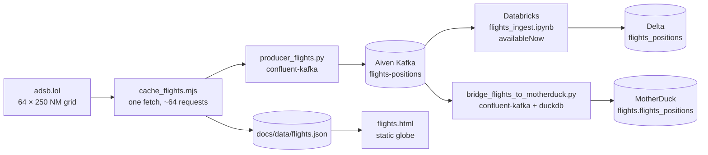

# Flights pipeline: GitHub Actions → Kafka → Databricks → MotherDuck

The flights page reads a static adsb.lol snapshot from GitHub Pages. This
pipeline adds the production-shaped path behind it, without replacing the static
one:



One adsb.lol fetch feeds all three consumers. The public API allows roughly 500
requests per day per IP and one grid pass spends about 64, so a second fetcher
would waste quota for no new data.

## Stages

| Stage | File | Trigger | Output |
|---|---|---|---|
| Fetch | `scripts/cache_flights.mjs` | `.github/workflows/flights_to_kafka.yml` cron | `docs/data/flights.json` |
| Produce | `producer_flights.py` | same workflow, after fetch | Kafka `flights-positions` |
| Ingest | `src/flights_ingest.ipynb` | Databricks job `flights_kafka_job` | Delta `flights_positions` |
| Bridge | `scripts/bridge_flights_to_motherduck.py` | same workflow, after produce | MotherDuck `flights.flights_positions` |

The hops are independent. If Databricks cannot reach Kafka, the bridge still
keeps MotherDuck current. If MotherDuck is unset, Kafka and Databricks still run.

## Kafka message

`producer_flights.py` writes one message per aircraft, keyed by `icao24`:

```json
{
  "timestamp": "2026-11-11T04:21:19Z",
  "icao24": "c8281b",
  "callsign": "PLC2",
  "country": "New Zealand",
  "lat": -36.9021,
  "lon": 174.7107,
  "last_update_ms": 1794370879487,
  "snapshot_id": "2026-11-11T04:21:20Z",
  "fetched_at": "2026-11-11T04:21:20Z",
  "source": "adsb.lol"
}
```

| Field | Type | Notes |
|---|---|---|
| `timestamp` | string | Aircraft position time, UTC ISO-8601 |
| `icao24` | string | Lowercase 24-bit ICAO address; Kafka key and dedupe key |
| `callsign` | string | Up to 10 characters, may be empty |
| `country` | string | Derived from the ICAO address block by the fetch step |
| `lat`, `lon` | double | Decimal degrees |
| `last_update_ms` | long | Position age in epoch milliseconds |
| `snapshot_id` | string | Snapshot time; one grid pass has one id |
| `fetched_at` | string | Snapshot fetch time |
| `source` | string | `adsb.lol` |

## Setup

1. Create the topic (once):

   ```bash
   export KAFKA_BOOTSTRAP="kafka-host:port"
   export KAFKA_PASSWORD="..."
   python scripts/create_kafka_topics.py
   ```

2. Deploy the Databricks job:

   ```bash
   databricks bundle validate --target dev
   databricks bundle deploy --target dev
   databricks bundle run flights_kafka_job --target dev
   ```

   The job reuses the existing `kafka-scope` secret and the
   `/Volumes/workspace/default/energy_realtime/aiven_ca.pem` trust file. The
   first run creates `/Volumes/workspace/default/energy_realtime/checkpoints-flights`.

3. Add repository secrets and variables:

   | Name | Kind | Purpose |
   |---|---|---|
   | `MOTHERDUCK_TOKEN` | secret | MotherDuck access token; bridge skips when unset |
   | `FLIGHTS_DATABRICKS_JOB_ID` | variable | Databricks job id; trigger skips when unset |
   | `FLIGHTS_TOPIC` | variable | Default `flights-positions` |
   | `MOTHERDUCK_DATABASE` | variable | Default `flights` |
   | `MOTHERDUCK_TABLE` | variable | Default `flights_positions` |

   Existing `KAFKA_BOOTSTRAP`, `KAFKA_USERNAME`, `KAFKA_PASSWORD`,
   `KAFKA_CA_PEM`, `DATABRICKS_HOST`, and `DATABRICKS_TOKEN` are reused.

4. Run the bridge once locally to create the warehouse table:

   ```bash
   export motherduck_token="..."
   export KAFKA_BOOTSTRAP="kafka-host:port"
   export KAFKA_PASSWORD="..."
   python scripts/bridge_flights_to_motherduck.py --dry-run
   python scripts/bridge_flights_to_motherduck.py
   ```

## Guardrails that keep the pipeline at $0

- **Never use `processingTime`.** Databricks serverless (Free Edition) raises
  `INFINITE_STREAMING_TRIGGER_NOT_SUPPORTED`. The notebook always ends with
  `.trigger(availableNow=True)`.
- **`failOnDataLoss=false`.** Aiven retention is about three days. If the job
  misses a longer window, the query skips the expired offsets instead of
  failing forever. The bridge sets `auto.offset.reset=earliest`, so it resumes
  from the oldest retained message.
- **`maxOffsetsPerTrigger=50000`.** Caps the first catch-up batch so a large
  backlog does not spike serverless usage.
- **One adsb.lol fetch.** The workflow keeps the 7-run schedule and the 64-region
  grid, staying under the 500/day/IP quota.
- **MotherDuck is read-only for dashboards.** Do transforms in Databricks or in
  the bridge, then query the small result set from MotherDuck.
- **Bridge is idempotent.** Offsets commit only after a successful upsert, and
  the upsert is keyed on `(icao24, observed_at)`, so re-delivery is safe.

### Free Edition egress caveat

Databricks Free Edition restricts outbound internet access to a limited set of
trusted domains. If the Aiven broker is not reachable from the workspace, the
`flights_kafka_job` task fails at the Kafka read with a connection or timeout
error. The bridge in GitHub Actions does not depend on Databricks, so MotherDuck
stays current. On a workspace without that restriction, the job runs unchanged.

## MotherDuck table

```sql
CREATE TABLE flights_positions (
    icao24 VARCHAR NOT NULL,
    callsign VARCHAR,
    country VARCHAR,
    lat DOUBLE,
    lon DOUBLE,
    observed_at TIMESTAMP NOT NULL,
    last_update_ms BIGINT,
    snapshot_id TIMESTAMP,
    fetched_at TIMESTAMP,
    source VARCHAR,
    ingested_at TIMESTAMP
);
```

Latest position per aircraft:

```sql
SELECT icao24, callsign, country, lat, lon, observed_at
FROM flights.flights_positions
QUALIFY row_number() OVER (PARTITION BY icao24 ORDER BY observed_at DESC) = 1;
```

## Adding another source

The pattern is one topic per source, one message contract per topic, one
Databricks notebook per topic, and one bridge table per topic:

1. Add the source producer, for example `producer_marine.py`, and produce to a
   new topic such as `marine-positions`.
2. Add the topic to `scripts/create_kafka_topics.py`.
3. Copy `src/flights_ingest.ipynb` and change the topic, checkpoint path, and
   schema. Add a task in `resources/flights_job.yml` or a new job resource.
4. Copy `scripts/bridge_flights_to_motherduck.py`, or generalize the topic,
   table, and row parser behind arguments.
5. Keep the same guardrails: `availableNow`, `failOnDataLoss=false`,
   `maxOffsetsPerTrigger`, idempotent upsert.
